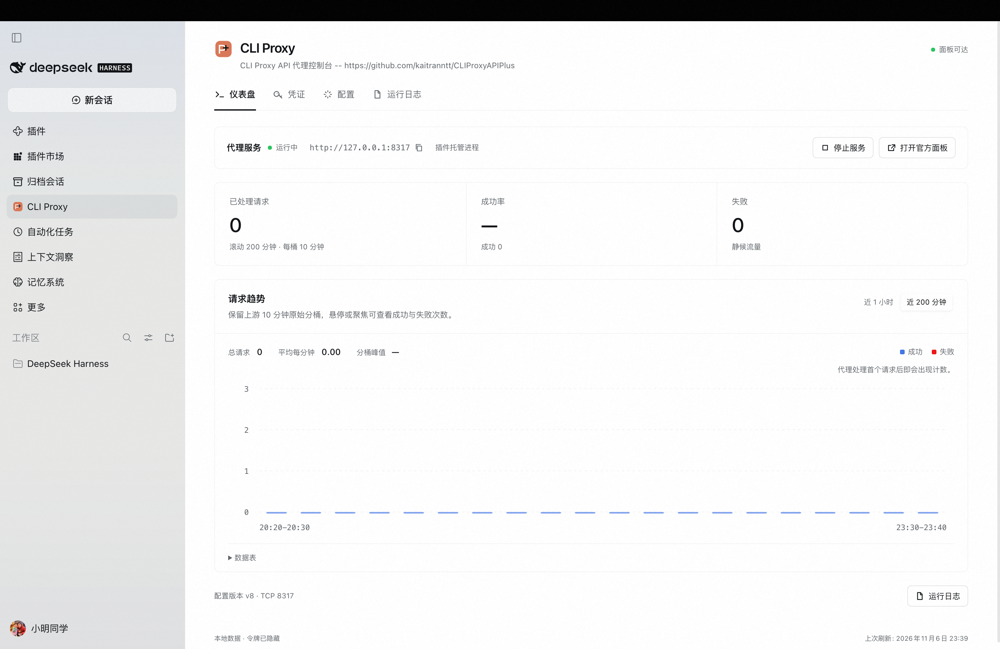
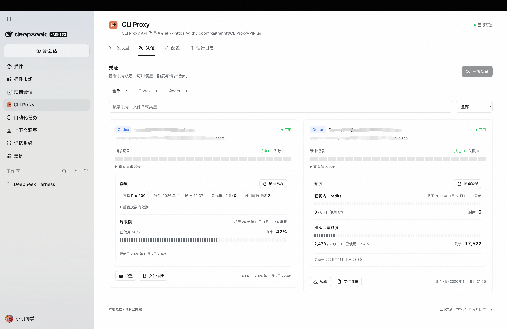
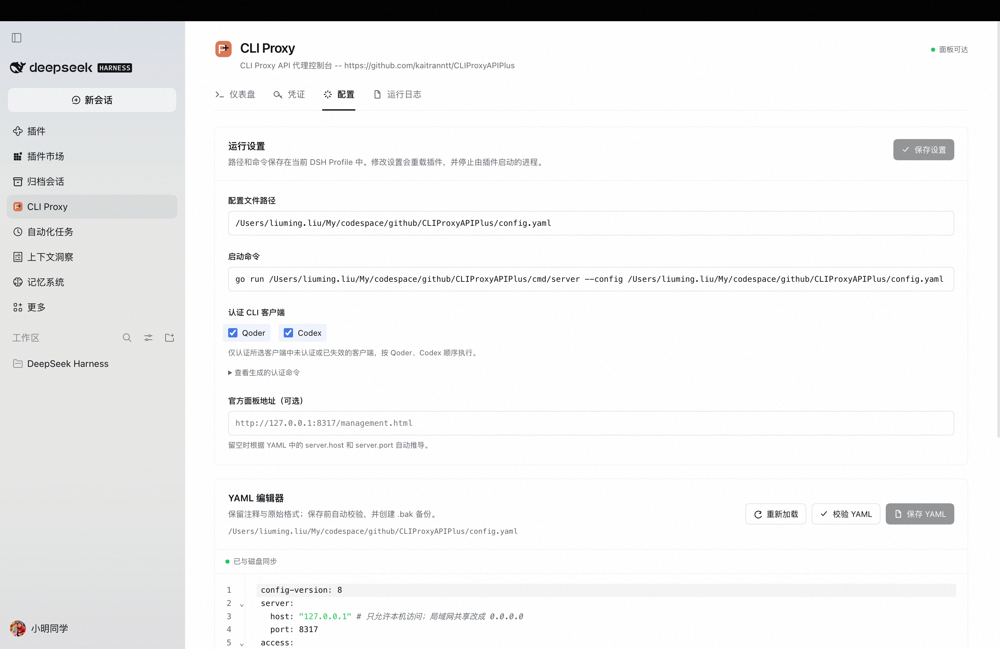

# CLI Proxy

A native DeepSeek Harness panel for a local [CLIProxyAPIPlus](https://github.com/kaitranntt/CLIProxyAPIPlus) checkout.

## Features

- Reads and edits `config.yaml` with a real CodeMirror 6 YAML editor, validation, external-change detection, and atomic `.bak` backups. One text engine owns highlighting, selection, and the caret, avoiding overlay drift.
- Shows handled requests, success rate, and failures in a compact dashboard. Request trends switch between the last hour and the last 200 minutes while preserving the upstream 10-minute buckets, with keyboard-accessible bars and a data table.
- Provides credential cards with provider and status filters, request history, quota balances, searchable model lists, and JSON file details with sensitive fields redacted before transport.
- Qoder quota separates package Credits and Shared Add-on Credits, each with used/total, remaining balance, and its own usage bar. The package reset date and plan name appear when supplied. When Qoder omits a total but supplies both used and remaining Credits, their sum provides the capacity; a remaining balance alone leaves capacity unknown. The panel queries the full Qoder quota API through the proxy using the selected credential and a token placeholder; OAuth tokens stay inside the proxy. Automatic reads share a 30-second cache, and **Refresh quota** always requests fresh data. Failed reads preserve the previous values.
- Starts and stops a configurable server command through the Harness subprocess service.
- Codex quota uses the selected credential to read plan, renewal, Credits balance, available reset count and expiry dates, plus 5-hour, weekly, monthly, code-review and additional usage windows when supplied. Optional subscription/reset failures preserve the core usage data. Reset credits are displayed without consuming them.
- Detects Qoder and Codex authentication from `oauth.auth-dir`. Select either or both **Authentication CLI clients** in Runtime settings. **One-click authentication** appends `--qoder-login` or `--codex-login` to the saved start command for selected clients with missing, expired, invalid, or incomplete credentials, or an explicit backend sign-in requirement. Valid clients are skipped. Commands run sequentially (Qoder, then Codex), with current-client progress, clickable login links and a stop action. Failure or cancellation stops the queue. The proxy can keep running throughout. Action banners stay in their originating tab and dismiss automatically after 30 seconds.
- Shows local configuration, non-sensitive account metadata, service health, and bounded runtime logs without signing in to the official management panel.
- Uses a DSH credential record for official management API access. Plugin-started servers receive the same `MANAGEMENT_PASSWORD`. Passwords never enter snapshots or agent results.
- Exposes the same Host operations through the `cliproxyapi_plus` agent tool.

The official management page remains available as an external link. The plugin does not recover or bypass its management password. The overview API omits tokens, management secrets, and authentication JSON. The file-details operation returns redacted JSON only.

## Screenshots

### Dashboard

Start and stop the local proxy, check connection status, and inspect request counts and success/failure trends.



### Credentials and quota

View Codex and Qoder accounts, refresh quota, inspect request history, and open available models or credential file details.



### Configuration

Save the configuration path and start command, choose authentication CLI clients, preview generated login commands, and edit YAML. The command field grows as text wraps.



## Defaults

Configuration path and start command default to empty; no authentication CLI client is selected initially. Set these in **Configuration → Runtime settings** and click **Save settings**. Saved paths, commands and client selections remain editable and are restored from the current Harness Profile after restarting Harness. Fields can be saved independently or cleared explicitly.

The optional official-panel URL is editable in the same section. Legacy `authCommand` settings with recognized `--qoder-login` or `--codex-login` flags infer the initial selections until `authClients` is saved explicitly. The old arbitrary authentication command is no longer executed; login commands always derive from `startCommand`. Saving plugin settings reloads the plugin and stops plugin-owned processes. Nothing starts automatically unless `autoStart` is explicitly enabled in the plugin configuration. An externally managed server is shown as connected and its port is reserved from the panel's start action.

## Automatic model providers

CLI Proxy creates `qoder` (Qoder) and `codex` (Codex) providers from the proxy's usable credentials and fills their model lists. Models from multiple accounts of the same client are combined and deduplicated using the proxy's route IDs. Qoder uses OpenAI Chat Completions and Codex uses OpenAI Responses through the configured proxy.

In **Configuration → Model provider sync**, choose periodic or one-time sync, change the check interval, or select **Sync now**. Periodic sync runs in the Host every 5 minutes by default, including while the panel is closed. Starting the proxy and completing authentication also trigger periodic-mode sync. One-time mode runs once on each plugin activation, with up to 30 seconds of cold-start readiness retries. Later retries are available through **Sync now**. The `modelSyncIntervalMinutes` setting accepts whole minutes from 1 to 35791, or `0` for one-time mode.

The proxy address comes from YAML. The first non-empty client API key in `access.api-keys` (or the legacy `api-keys` list) is validated and saved through Harness Credentials. A missing key is reported in the sync status. Providers and credential references persist in the current Profile. Existing `qoder` and `codex` provider configurations are overwritten. Connection, authentication, model-query, and partial-account failures retain the last successful configuration for the affected client. The authentication-client checkboxes continue to control login commands.

The Host agent tool supports `sync_providers` for the same manual synchronization. A writable Profile and the standard `settings`, `credentials`, and `llm-pi-ai` services are required for provider sync.

## Install

In the Harness Plugin Manager, install the npm package [`cliproxyapi-plus`](https://www.npmjs.com/package/cliproxyapi-plus) and enable it. For local development, select the package directory from this repository.

## Develop

```sh
pnpm install --ignore-scripts
pnpm test
pnpm run test:browser
pnpm run check
pnpm run pack:check
```

The test suite uses temporary files and fake subprocesses; it does not start the real proxy or modify the real `config.yaml`.

## Security model

The UI invokes fixed Host operations using paths and commands from saved configuration. Credential requests accept only a JSON filename. Models, file details, and quota access use authenticated management endpoints. Authentication scanning ignores symlinks and returns an allowlist of non-sensitive metadata. Runtime logs stay in the local panel. The agent snapshot tool replaces log bodies with a panel pointer.

This plugin manages only processes it started. It does not claim ownership of an externally launched process using the same port.
